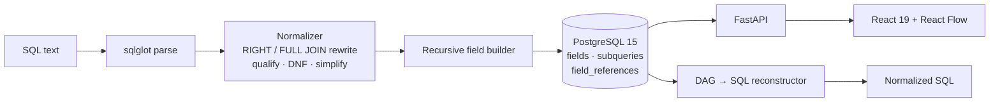

<div align="center">

# SQLineage

**Field-level SQL lineage, built on a content-addressed DAG.**

Parse a SQL query, get a column-level dependency graph that can be explored
visually and reconstructed back into normalized SQL.

[](LICENSE)
[](https://www.python.org/)
[](https://react.dev/)
[](https://www.postgresql.org/)

*Status: v0.1.0 — usable and under active development.*

</div>

---

## Why SQLineage?

Most lineage tools stop at the table level: *"query A feeds table B."* SQLineage
goes one level deeper and models **every field as a first-class, immutable node**
identified by the SHA-256 of its canonical expression. That makes the graph:

- **Column-accurate** — follow a single value through joins, filters, aggregations,
  subqueries and window functions.
- **Idempotent** — identical expressions share a hash, so re-building the same SQL
  never duplicates nodes. Fields are never deleted; orphaned nodes simply fall out
  of reach.
- **Reversible** — the DAG can be rendered back to standardized SQL, not just drawn.
- **Sugar-free** — constructs like `HAVING` are de-sugared into the semantic
  primitives they really are, so the graph reflects meaning instead of syntax.

## Features

- **SQL → field-level DAG.** `sqlglot` parse → normalize → recursive field builder.
- **DAG → SQL reconstruction.** Per-node rendering rules (`_SPEC`) rebuild a full,
  self-contained query from any field hash, including subqueries and projections.
- **Two-layer wrapping model.** Column references wrap in `join` / `where`;
  aggregations wrap in `groupby`; projections wrap in `where` / `limt`.
- **Semantic normalization.** `RIGHT JOIN` → `LEFT JOIN`, `FULL JOIN` → `UNION` of
  left joins, `qualify` → DNF → `simplify`, `HAVING` folded into `WHERE` at the
  right DAG depth.
- **Schema management.** Databases, tables, columns, DDL parsing, and manual
  table definitions.
- **Build history & upgrade.** Trace a field from root to sink, cascade upgrades
  and downgrades across downstream tables.
- **Interactive workbench.** React Flow graph, node search, node/table detail
  pages, one-click *Reconstruct SQL*, admin user and stats pages.
- **Bundled test corpus.** 38 internal queries plus 170 BIRD text-to-SQL samples,
  81 backend tests.

## How it works



1. **Parse** — `sqlglot` turns the query into an AST (dialect-aware).
2. **Normalize** — right/full joins are rewritten, identifiers are qualified,
   predicates are put in disjunctive normal form, and constant expressions are folded.
3. **Build** — each output column becomes a field node; operands become references
   to other fields, subqueries or tables.
4. **Persist** — nodes are content-addressed and upserted, so the store is a DAG,
   not a tree of query copies.
5. **Explore / reconstruct** — the API serves graph and SQL views to the UI.

### Core concepts

**Field as a first-class citizen**

| Concept | Detail |
|---|---|
| Content addressing | `sha256(canonical_json(expr))[:16]`; equal expressions share a hash |
| Field kinds | `atomic`, `literal`, `expression`, `atomic_condition`, `composite_condition` |
| Immutability | `fields` is append-only; stale nodes become unreachable but remain in place |
| Edges | `field_references` links a field to the fields/subqueries/tables it consumes |

**Wrapping layers**

```text
column layer:  atomic → join(column, on) → where(column, condition)
aggregate:     sum → groupby(agg, keys)
projection:    result → where(result, condition) → limt(result, n, order_by)
```

| Wrapper | Layer | Meaning |
|---|---|---|
| `join` | column | Restricts the value domain with an `ON` predicate |
| `where` | column / projection | Filters rows (wrapping a column) or groups (wrapping an aggregate) |
| `groupby` | aggregate | Groups an aggregation |
| `limt` | projection | Row limit plus sort direction |

**De-sugaring.** `HAVING` is treated as a `WHERE` over aggregated results and is
merged into a `where` node; the DAG position (wrapping a column vs. a `groupby`)
carries the distinction. Reconstruction emits a subquery + `WHERE` rather than `HAVING`.
Grouped operands inside conditions become an internal projection state
(`__PROJ_ENUM__`) that downstream nodes resolve to a concrete projection.

**Reconstruction.** `sql_reconstructor.py` classifies every `op` through a
`(shape, param, prop)` spec table. Unknown scalar functions fall back to a prefix
form (`OP(args)`), so the engine degrades gracefully. Output is *standardized* SQL:
different input spellings that mean the same thing reconstruct to the same statement.

## Tech stack

| Layer | Stack |
|---|---|
| Backend | Python 3.13, FastAPI 0.115, sqlglot 25.34, psycopg2 |
| Frontend | React 19, TypeScript, Vite 8, Tailwind CSS 4, React Flow (`@xyflow/react`), elkjs, Zustand |
| Database | PostgreSQL 15 |
| Auth | JWT (python-jose) + bcrypt (passlib) |
| Tests / lint | pytest 8, ruff, oxlint |

## Getting started

### Prerequisites

- Python **3.13** (the Makefile invokes `python3.13`)
- Node.js **20.19+** (required by Vite 8)
- PostgreSQL **15+**, running locally
- `make`

### Install

```bash
git clone https://github.com/Clara-zy/sqlineage.git
cd sqlineage

cp .env.example .env
# edit POSTGRES_* to match your local PostgreSQL

# create the role and database once
psql -U postgres -c "CREATE USER sqlineage WITH PASSWORD 'your_password';"
psql -U postgres -c "CREATE DATABASE sqlineage OWNER sqlineage;"

make install     # Python venv + pip + npm install
make db-init     # schema, seed data (22 demo tables), default admin user
```

### Run

```bash
make dev
```

| Service | URL |
|---|---|
| Frontend | http://localhost:5173 |
| API | http://localhost:8000 |
| OpenAPI docs | http://localhost:8000/docs |
| Health check | http://localhost:8000/api/health |

Log in with the seeded local admin — **`admin` / `nbkknb`** — and change it before
exposing the service to anyone.

Optional: load the bundled corpus (38 internal + 170 BIRD queries).

```bash
make import-all
```

### Common commands

| Command | What it does |
|---|---|
| `make dev` | Start backend (`:8000`) and frontend (`:5173`) |
| `make backend` / `make frontend` | Start one side only |
| `make stop` | Kill both dev servers |
| `make db-init` | Create schema and seed demo tables |
| `make import-all` | Import the internal + BIRD test corpus |
| `make test` | Run the 81 backend tests |
| `make test ARGS="-k join"` | Filter tests by keyword |
| `make lint` | ruff + oxlint |
| `make reset` | Clear lineage data and re-import the corpus |
| `make clean` | Remove caches and build output |

> The test suite uses a real PostgreSQL database. Run `make db-init` first.

## Using the workbench

1. **Define schemas** under *Databases* → *Tables*. Create tables manually or paste DDL.
2. **Build lineage** on the *Workbench* tab: pick a sink table, paste SQL, and build.
3. **Explore the graph** — click a node for its expression, dependencies and enum values;
   use *Reconstruct SQL* to turn any field back into a complete query.
4. **Search nodes** and inspect *table detail* pages for column mappings and build history.
5. **Review upgrades** — preview a root → sink upgrade and cascade it downstream.

## API overview

All endpoints are under `/api/v1` (except the health check) and require a bearer
token from `POST /api/v1/auth/login`.

| Group | Highlights |
|---|---|
| `/auth` | `login`, `logout`, `me` |
| `/users` | list / create / update / delete users (admin) |
| `/databases` | CRUD, delete preview |
| `/tables` | CRUD, DDL import, column mapping history, input lineage history, downgrade |
| `/lineage` | `build`, `graph`, `history`, `overview`, `node/{hash}`, `field-sql/{hash}`, `upgrade/preview`, `upgrade/execute`, `clear` |

## Repository layout

```text
.
├── backend/
│   ├── app/
│   │   ├── main.py                  FastAPI entry point
│   │   ├── api/                     REST endpoints (auth, users, databases, tables, lineage)
│   │   ├── lineage_engine/          parser, normalizer, field & subquery builders
│   │   ├── upgrade_engine/          root → sink upgrade and cascade
│   │   ├── sql_reconstructor.py     DAG → SQL renderer (`_SPEC` spec table)
│   │   ├── field_enums.py           enum value resolution / inheritance
│   │   ├── schema.sql               PostgreSQL schema
│   │   └── seed.py                  demo tables (mydb 9 + BIRD 13)
│   ├── tests/                       81 pytest tests
│   └── requirements.txt
├── frontend/
│   └── src/
│       ├── pages/                   workbench, test cases, tables, nodes, admin …
│       ├── components/              navbar, side panel, pagination
│       └── stores/                  Zustand stores
├── resource/
│   ├── test_sqls.json               38 internal test queries
│   └── BIRD_SUBSET/                 BIRD financial + debit_card_specializing subset
├── 设计文档/                         design documents (Chinese)
├── Makefile
└── .env.example
```

## Limitations & roadmap

- **Normalization is intentional.** Reconstruction produces standardized SQL rather
  than reproducing the original text, so semantically equivalent queries may render
  differently from what you typed.
- **Non-aliased aggregates.** Column naming for conditions such as
  `HAVING count(*) > 5` without an `AS` alias is still on the roadmap.
- **Whole-query path.** `subquery_to_sql` does not yet apply HAVING de-sugaring end to end.
- **Dialect coverage.** The engine accepts a sqlglot dialect, but the HTTP API currently
  builds with the default dialect. Production Hive SQL was cleaned with
  `backend/app/sql_preprocess.py` before import; that script needs private
  `resource/UP_SUBSET/` inputs which are not part of this repository.
- **Private-resource targets.** The `make platform-import` and `make preprocess-sql`
  targets likewise depend on `resource/UP_SUBSET/` and are inert in a fresh clone.
- **Deployment.** Local development is the supported path today; there is no Docker
  Compose or production deployment recipe yet.

Contributions that close any of the above are very welcome.

## Data attribution

`resource/BIRD_SUBSET/` is a subset of the [BIRD](https://bird-bench.github.io/)
text-to-SQL benchmark (databases `financial` and `debit_card_specializing`), and is
redistributed here under **CC BY-SA 4.0**. The SQLite database files (~100 MB) are not
tracked in Git — see `.gitignore`. Download them from the BIRD distribution if you
want to execute queries against the sample databases; the schema descriptions under
`dev_databases/*/database_description/` are still included.

## Contributing

1. Fork the repository and create a topic branch.
2. Keep changes focused and add tests where behavior changes.
3. Run `make lint` and `make test` before opening a pull request.
4. Describe the motivation and the resulting behavior in the PR.

Bug reports and design discussions are welcome via GitHub Issues. The design
documents under `设计文档/` (Chinese) explain the engine internals in depth.

## License

Released under the [MIT License](LICENSE).
© 2026 SQLineage Contributors.

## Acknowledgements

This project stands on [sqlglot](https://github.com/tobymao/sqlglot) for SQL parsing
and optimization, [React Flow](https://reactflow.dev/) and [ELK](https://github.com/kieler/elkjs)
for graph layout, and the [BIRD benchmark](https://bird-bench.github.io/) for its
open text-to-SQL corpus.
